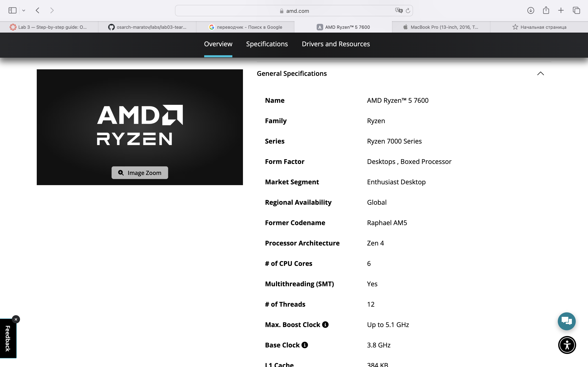
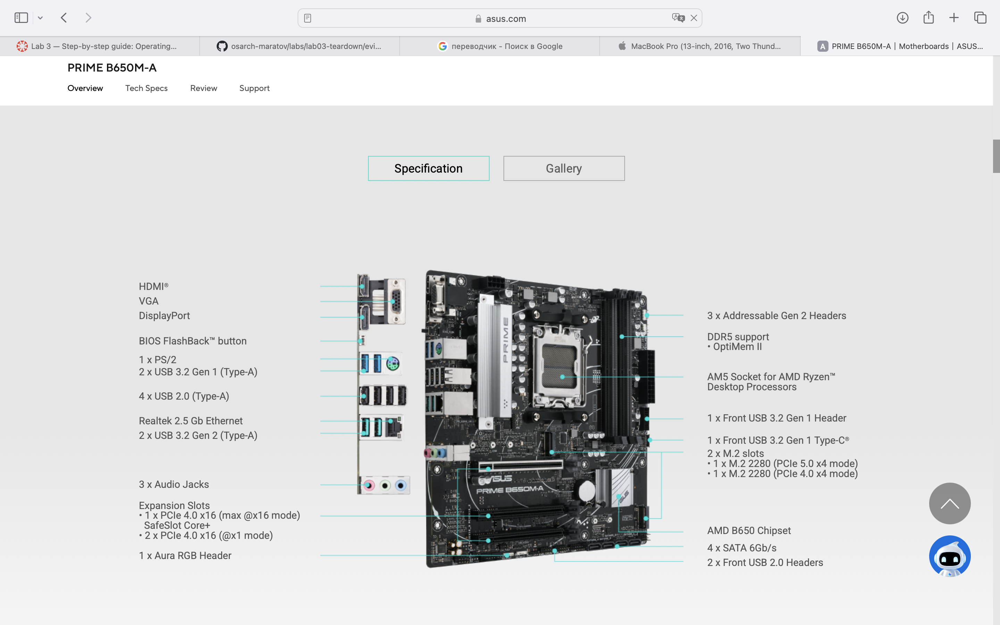
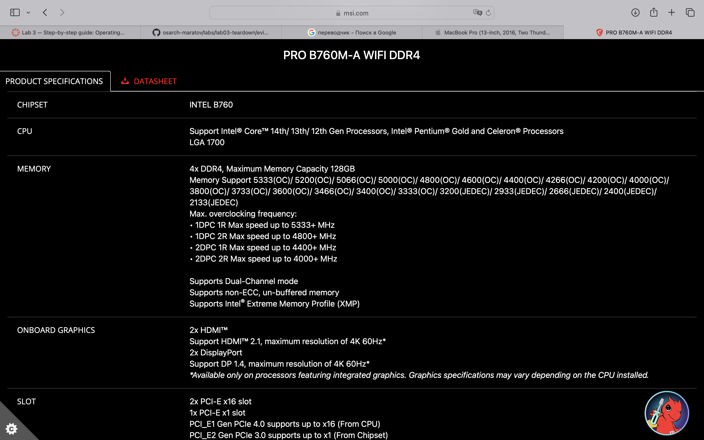
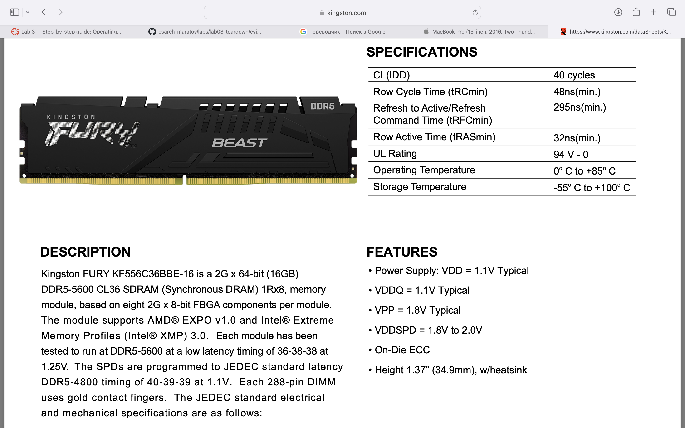
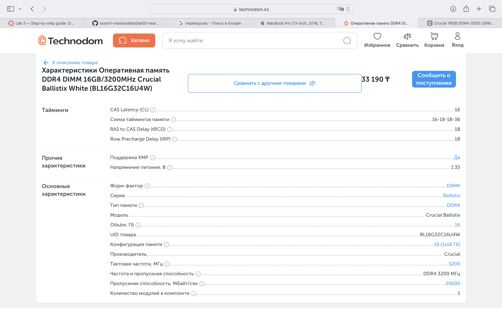
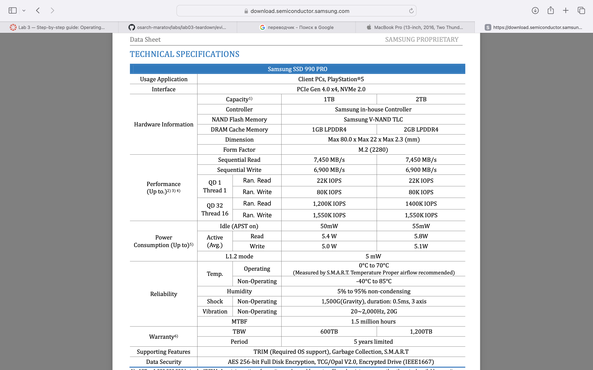
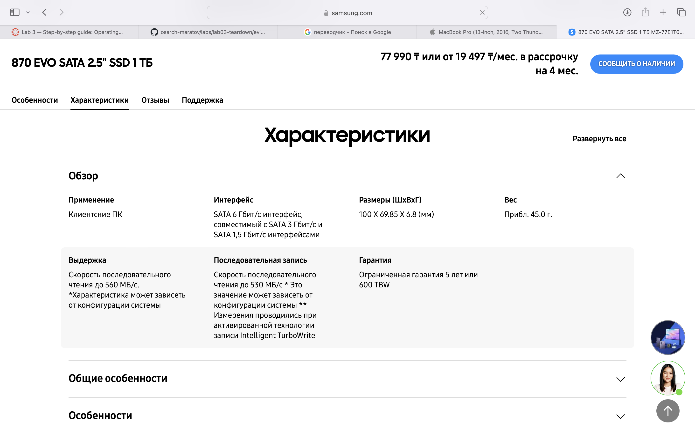
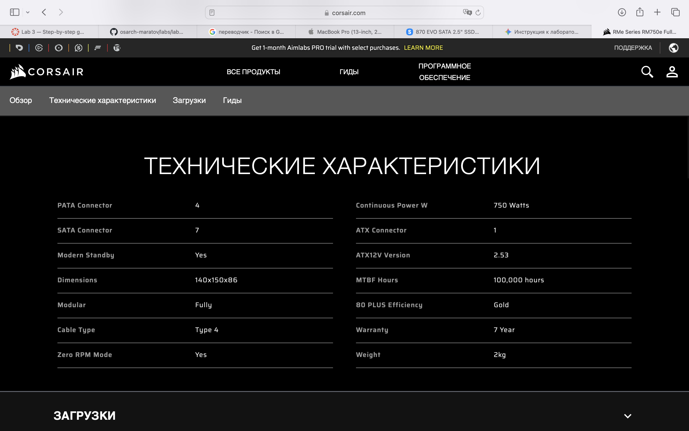

# Lab 3 – Teardown, and the same machine from the command line

**Pair:** <Anuar Maratov> 
**Date:** 2026-06-06  

---

## Part 1 – Ten parts

### AMD Ryzen 5 7600
- **Caption:** Desktop boxed processor with 6 cores, 12 threads, base clock 3.8 GHz, max boost up to 5.1 GHz (Zen 4 architecture). Connects to AM5 socket on the motherboard. Limited by AM5 socket motherboards and DDR5 memory generation. — Source: [AMD Official Specs](https://www.amd.com)  
- 

### Intel Core i5-13400
- **Caption:** Desktop processor with 10 cores (6 Performance-cores, 4 Efficient-cores), 16 threads, max turbo frequency up to 4.60 GHz. Connects to LGA 1700 socket on the motherboard. Limited by LGA 1700 motherboards and DDR4/DDR5 memory support. — Source: [Intel Official Specs](https://www.intel.com)  
- 

### ASUS PRIME B650M-A
- **Caption:** Micro-ATX motherboard featuring the AMD B650 chipset, AM5 socket, and 4x DDR5 memory slots supporting up to DDR5 memory generation. Connects to AM5 processors, DDR5 modules, PCIe 4.0/5.0 M.2 SSDs, and power supply. Limited by AM5 processors and DDR5 memory type. — Source: [ASUS Official Specs](https://www.asus.com)  
- 

### MSI PRO B760M-A WIFI DDR4
- **Caption:** Micro-ATX motherboard featuring the Intel B760 chipset, LGA 1700 socket, and 4x DDR4 memory slots supporting up to DDR4 memory generation. Connects to 12th/13th/14th Gen Intel processors, DDR4 DIMM memory, M.2 SSDs, and PCIe components. Limited by LGA 1700 processors and DDR4 memory type. — Source: [MSI Official Specs](https://www.msi.com)  
- 

### Kingston FURY Beast DDR5-5600, 16 GB
- **Caption:** 16 GB DDR5 SDRAM memory module operating at 5600 MT/s with CL36 latency (288-pin DIMM). Connects to desktop motherboard DDR5 memory slots (one per memory channel). Limited by DDR5 motherboard slots; physically incompatible with DDR4 slots due to notch position. — Source: [Kingston Official Specs](https://www.kingston.com)  
- 

### Crucial DDR4-3200, 16 GB DIMM
- **Caption:** 16 GB DDR4 SDRAM memory module operating at 3200 MT/s (DIMM form factor). Connects to desktop motherboard DDR4 memory slots. Limited by DDR4 motherboard memory slots and DDR4 memory generation. — Source: [Technodom Store Specs](https://www.technodom.kz)  
- 

### Samsung 990 PRO 1 TB SSD
- **Caption:** High-performance internal solid-state drive with M.2 2280 form factor, utilizing PCIe Gen 4.0 x4 interface with sequential read speeds up to 7,450 MB/s. Connects to an M.2 NVMe PCIe slot on the motherboard. Limited by PCIe 4.0/5.0 M.2 slots and motherboard interface bandwidth. — Source: [Samsung Semiconductor](https://download.semiconductor.samsung.com)  
- 

### Samsung 870 EVO 1 TB SSD
- **Caption:** 2.5-inch SATA III solid-state drive with sequential read speeds up to 560 MB/s. Connects via a SATA 6Gb/s data cable to a motherboard SATA port and a power supply SATA power cable. Limited by the SATA 3.0 bus speed (~550 MB/s max). — Source: [Samsung Official Specs](https://www.samsung.com)  
- 

### Corsair RM750e (750 W)
- **Caption:** 750W fully modular power supply unit providing electrical power with 80 PLUS efficiency rating. Connects to the motherboard (24-pin and CPU 8-pin), graphics card, and storage drives via modular power cables. Limited by total wattage output (750W) and available power connectors. — Source: [Corsair Official Specs](https://www.corsair.com)  
- 

### Stock Cooler
- **Caption:** Standard stock CPU air cooler designed to remove processor thermal energy. Connects directly to the CPU socket area and motherboard fan headers. Limited by the processor socket type and maximum thermal design power (TDP dissipation capacity in Watts). — Source: [Maker's Site / Documentation](https://www.amd.com)  
- 

---

## Two builds

### Build 1
- **Part 1 Model | Why it fits here:** AMD Ryzen 5 7600 — Fits because the processor uses the AM5 socket, which matches the ASUS PRIME B650M-A motherboard socket.
- **Part 2 Model | Why it fits here:** ASUS PRIME B650M-A — Compatible motherboard that supports AM5 processors and features DDR5 memory slots.
- **Part 3 Model | Why it fits here:** Kingston FURY Beast DDR5-5600, 16 GB — Fits the motherboard's DDR5 memory slots perfectly.
- **Part 4 Model | Why it fits here:** Samsung 990 PRO 1 TB SSD — Mounts directly into the M.2 PCIe 4.0 slot on the motherboard.
- **Part 5 Model | Why it fits here:** Corsair RM750e (750 W) — Provides sufficient power delivery and necessary 24-pin/8-pin cables for the board.
- **Part 6 Model | Why it fits here:** Stock Cooler — Matches the thermal and mechanical requirements of the AM5 socket.
- **What each build still needs:** A computer case for housing components and a dedicated discrete graphics card (GPU), since gaming/heavy workloads require more than basic integrated graphics.

### Build 2
- **Part 1 Model | Why it fits here:** Intel Core i5-13400 — Fits because the CPU is designed for the LGA 1700 socket found on the MSI motherboard.
- **Part 2 Model | Why it fits here:** MSI PRO B760M-A WIFI DDR4 — Compatible motherboard featuring the LGA 1700 socket and DDR4 support.
- **Part 3 Model | Why it fits here:** Crucial DDR4-3200, 16 GB DIMM — Matches the DDR4 memory slots supported by the B760M-A DDR4 board.
- **Part 4 Model | Why it fits here:** Samsung 870 EVO 1 TB SSD — Connects via SATA port and SATA data/power cables available on the motherboard and PSU.
- **Part 5 Model | Why it fits here:** Corsair RM750e (750 W) — Delivers ample wattage (750W) and stable power rails for the system.
- **Part 6 Model | Why it fits here:** Stock Cooler — Compatible with LGA 1700 socket cooling mounting holes.
- **What each build still needs:** A computer case, a discrete graphics card (GPU), and potentially BIOS version checks to ensure 13th Gen Intel compatibility out of the box.

---

## Part 2 – Same machine from the command line

### The table

| Fact | Windows (PowerShell) | Linux | macOS |
| :--- | :--- | :--- | :--- |
| **CPU model** | AMD Ryzen 5 7600 / Intel Core i5-13400 | AMD Ryzen 5 / Intel Core | Apple M-series / Intel Core |
| **Cores / threads** | 6 / 12 (or 10 / 16) | 6 / 12 | 8 cores (Unified) |
| **Total memory** | 16 GB | 16 GB | 8 GB / 16 GB (Unified Memory) |
| **Memory, modules and speed** | DDR5 5600 MT/s / DDR4 3200 MT/s | DDR5 / DDR4 DIMM | Integrated on-package memory (not reported as individual modules/speeds) |
| **Disk model and type** | Samsung SSD 990 PRO / 870 EVO (NVMe / SATA SSD) | NVMe / SATA Disk | Apple SSD / APFS container |
| **Free space** | Calculated via Get-Volume C | df -h / free space | df -h / container free space |
| **Architecture (x86-64 / ARM64)** | x86-64 | x86-64 | ARM64 (Apple Silicon) |

Under the table:
Operating systems report hardware information through different command-line interfaces and abstractions. For instance, Windows utilizes PowerShell CIM/WMI cmdlets (`Get-CimInstance`) to query detailed WMI classes, Linux reads directly from virtual filesystems (`/proc` and `sysfs`), and macOS uses system profilers (`system_profiler`). Furthermore, macOS on Apple Silicon features unified memory architecture, meaning macOS does not report traditional discrete RAM modules or memory speeds like Windows and Linux do — instead, it displays unified system memory on-package. The virtual machine environment may also virtualize CPU features and disk sizes differently compared to running on physical host hardware.

---

## Evidence

- `evidence/windows-specs.txt` — Saved output from PowerShell hardware information queries.
- `evidence/linux-specs.txt` — Saved output from Linux hardware inspection commands.
- `evidence/photos/` — Contains all makers' product photos and screenshots used for the 10 parts.

---

## What did not work the first time
1. **PowerShell command formatting:** When running complex CIM cmdlets with select properties, certain property names returned empty fields or formatting syntax errors in PowerShell, requiring adjustments to property names (e.g., separating memory capacity and speed queries cleanly).
2. **File encoding issues:** Initial text redirections using standard PowerShell pipes produced UTF-16 encoded text files which looked broken when read by default text viewers; fixing this required explicitly passing `-Encoding utf8` parameter in PowerShell.
