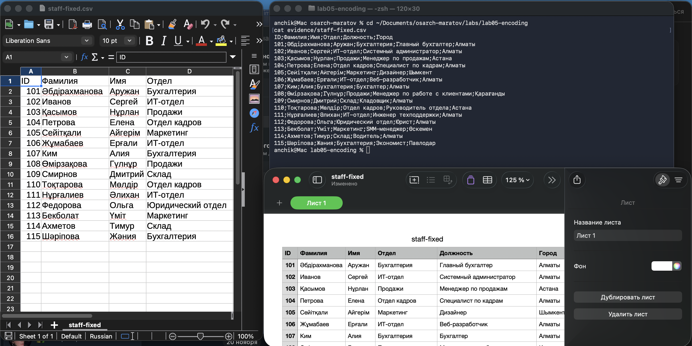

# Lab 5 — Encoding forensics

Name: Anuar Maratov · Date: 22.11.2026 · Tools: macOS Terminal (`file`, `xxd`, `iconv`), LibreOffice Calc, Numbers; MacBook Air M5

## What I received
`staff-broken.csv` (852 bytes, 16 lines: a header and 15 staff rows, separator `;`).

- **Terminal:** the file is not UTF-8, so the Cyrillic text cannot be read directly; `cat -A` shows the letters as raw single bytes (`M-...`).
- **LibreOffice / Numbers / Excel:** I did not open the original in them before the diagnosis (see "What did not work"); I opened only the fixed file.

## Diagnosis (made before the fix)
- `file` said: `Non-ISO extended-ASCII text, with CRLF line terminators` (evidence/file-before.txt). It does not name the code page.
- First 16 bytes: `49 44 3b d4 e0 ec e8 eb e8 ff 3b c8 ec ff 3b ce` (evidence/hexdump-before.txt)
- **Encoding: RK1048 (KZ-1048, the Kazakh variant of Windows-1251)** — because every Cyrillic letter is one byte (`Ф` = `D4`, `а` = `E0`, `я` = `FF`), and the Kazakh letters are single bytes too: `Ә` = `A3` (offset 0x2A, in `Әбдірахманова`) and `Қ` = `8D` (offset 0xA4, in `Қасымов`). Windows-1251 reads `A3` as `Ј` and `8D` is not a Kazakh letter there, so only RK1048 decodes every name correctly.
- **Line ending: CRLF** — because line 1 ends with `0D 0A` (`ee e4 0d 0a`); 16 CRLF, 0 bare LF.
- **BOM: no** — because the file starts with `49 44` ("ID"), not `EF BB BF` or `FF FE`.
- **Separator:** `;`
- In the fixed file I **added** a BOM, because, according to common documentation, Excel on Windows only recognises UTF-8 by double-click when the file starts with `EF BB BF` (**this was not tested by me, see "Review feedback"**). The price is that a script can see the BOM as part of the first column name (`\ufeffID`); for scripts the BOM can be stripped.
- I **kept CRLF**, because the source already is CRLF and Windows/Excel users expect it. A Linux script would need `sed -i 's/\r$//'`.

## Fix
`scripts/fix.sh` (run from `labs/lab05-encoding/`):

```sh
iconv -f RK1048 -t UTF-8 evidence/staff-broken.csv > evidence/.staff-fixed.tmp
printf '\357\273\277' | cat - evidence/.staff-fixed.tmp > evidence/staff-fixed.csv
```

## Verification
`evidence/file-after.txt`: `Unicode text, UTF-8 (with BOM) text, with CRLF line terminators`. Cyrillic letters are `D0 xx` / `D1 xx` pairs; the Kazakh names (Әбдірахманова, Қасымов, Нұрлан, Өмірзақова…) read correctly in `cat`. The original `evidence/staff-broken.csv` is unchanged (SHA-256 `fecc66e3…e41f`).

`evidence/opens-correctly.png` shows the fixed file opened in three places side by side: LibreOffice Calc (columns split on `;`), Numbers (used instead of Excel, which is not installed) and the terminal (`cat evidence/staff-fixed.csv`). In all three the Cyrillic and Kazakh letters (Ә, Қ, Ұ, Ө, Ғ, Ү, І) are correct, each field is in its own column, and the first column header is a clean `ID` (the BOM is not visible).



## What did not work the first time
- `file` only said "Non-ISO extended-ASCII text": it cannot tell Windows-1251 from KZ-1048. My first guess, Windows-1251, gave wrong Kazakh letters (`Јбдірахманова`, `Ќасымов`, `Нўрлан`), so I looked at the bytes (`A3`, `8D`) and switched to RK1048.
- Excel is not installed on this Mac, so I used **Numbers** as the second application, and I had to install LibreOffice first.
- I skipped Step 1 of the guide (opening the original in the applications before the diagnosis) and diagnosed from `file` and the bytes only, so I have no screenshots of how the original looks in them.
- `git push` was rejected (`fetch first`) because the remote had commits that I did not have on this Mac. I ran `git pull --rebase` and pushed again.

## AI use
I used Claude (Anthropic) to run the diagnosis commands, write `scripts/fix.sh` and draft this README. TODO (Anuar): check the bytes and the BOM / line-ending decision yourself and be ready to explain them in 60 seconds.

## Review feedback and what is still open
The review noted that the task asks for Excel, LibreOffice Calc and a terminal, while my screenshot uses Numbers instead of Excel, so the reason for adding the BOM (Excel double-click) was never tested.
- **What is verified:** the fixed file shows the Kazakh letters correctly in LibreOffice Calc, Numbers and the terminal (`evidence/opens-correctly.png`).
- **What is not verified:** that Excel needs the BOM. I have no Excel on this Mac, so the BOM decision rests on documentation, not on my own test.
- **How to close it:** open `evidence/staff-broken.csv` and `evidence/staff-fixed.csv` by double-click in Excel (Windows or Mac), screenshot both, and compare: the expectation is that the file without BOM shows garbled letters and the file with BOM shows Ә, Қ, Ұ correctly. Until that is done, this part is open.
